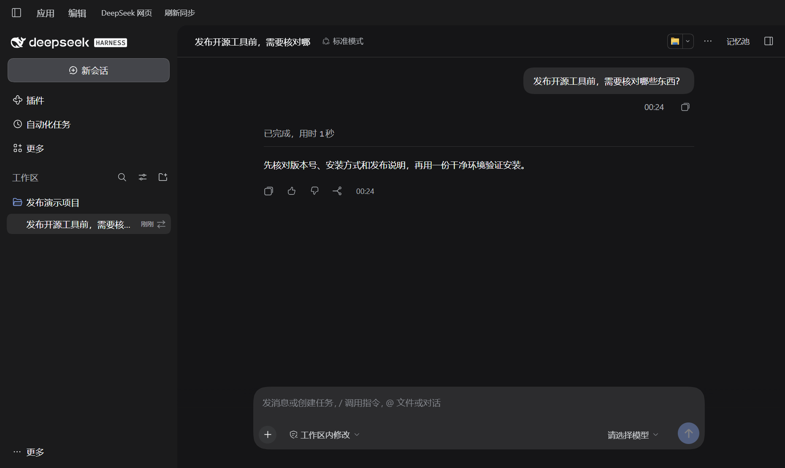
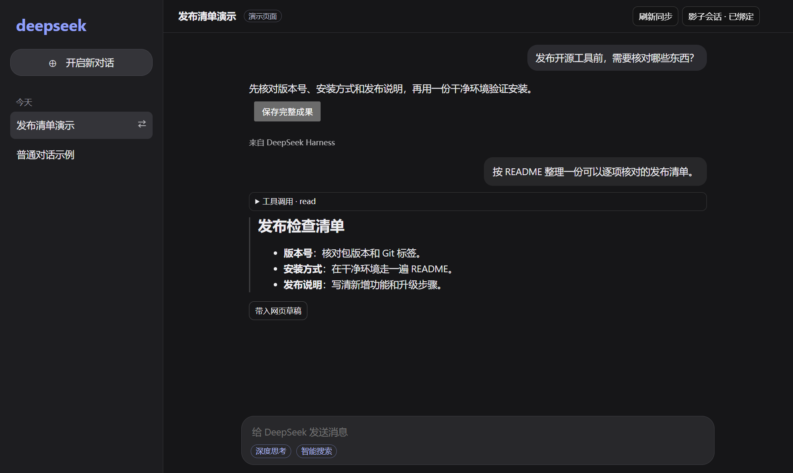

# dsh-ecolink

**在 DeepSeek 网页查资料，交给 Harness 做事，再回到原对话看结果。** Ecolink 把 DeepSeek 网页和 DeepSeek Harness（DSH）放进同一个桌面窗口，让网页问答、项目任务和本地记忆接得上。

> **v1.1.0 新增影子会话**。把一条 DeepSeek 网页对话绑定到一个 Harness 项目会话。网页问答可以同步到 Harness，Harness 完成的回答会回显在网页里，切换窗口里的两端就能接着看。

[快速安装](#快速安装) · [试一次影子会话](#试一次影子会话) · [桌面补丁安装与回退](desktop/README.md) · [下载源码](https://github.com/Zoria-Lind/dsh-ecolink/tags)

## 试一次影子会话

比如你想让 DeepSeek 先帮你找接口资料，再让 Harness 根据资料改项目里的代码。装好 **adapter v1.1.0 和同版本桌面补丁** 后：

1. 点 DSH 左上角「DeepSeek 网页」。在网页右上角打开「影子会话」，选项目，点「新建影子会话」；已有网页对话也可以点「绑定此会话」。
2. 在网页里照常聊天、用智能搜索。想把已完成的网页问答带给 Harness，点「同步到 Harness」或「刷新同步」。要让 Harness 动手，点「交办给 DSH」，写下任务，还可以附上最近一轮网页问答，再点「确认交办」。
3. Harness 完成后，回到原网页对话查看回答。标题、列表、代码等按 Markdown 显示，工具调用默认折叠。想让网页模型接着分析，可以点「带入网页草稿」，检查后自行发送。

在已绑定的会话里，两边都可以点「刷新同步」补齐问答，也可以用 **Ctrl+R**。在 Harness 按 Ctrl+R，会重新读取当前绑定网页的历史；在内置网页按 Ctrl+R，会先重载页面，等原对话加载后再同步。普通网页会话的 Ctrl+R 照常刷新页面。

影子会话只同步已完成的问答。遇到历史尚未加载、回复仍在生成或分支不一致时，会提示等待或重新打开原分支。Harness 回答在网页中的回显保存在本地，不会改写 DeepSeek 服务端的对话历史。

**网页 → Harness**。同步后的网页问答出现在绑定的 Harness 会话里，顶部可以「刷新同步」。



**Harness → 网页**。回到内置网页就能看清单、展开工具调用，或把回答带入草稿。下图使用本地模拟网页和演示数据，回显由 Ecolink 渲染。



## 快速安装

适配层需要 **Node.js 18+**，实测宿主为 **DSH `0.2.2-rc.1`**。桌面补丁适用于该版本的 Windows 桌面客户端。

| 想用什么 | 需要安装什么 |
| --- | --- |
| 在 Harness 搜索记忆、查看全文、把选中的内容带入对话 | **adapter**，可从 DSH 插件市场安装 |
| 同窗切换、影子会话、同步问答、网页交办 | **adapter v1.1.0 + 同版本桌面补丁** |
| 在普通 Chrome / Edge 的 DeepSeek 网页收集记忆、保存回答或自动注入 | **浏览器扩展 + 本地服务**，已装 adapter 就直接复用它自带的服务 |

### 1. 安装 DSH 插件

打开 DSH 的「插件市场」，搜索 `ecolink`，找到作者为 **Zoria-Lind** 的 `adapter`，点「安装」。[市场条目](https://awesome-dsh-plugin.com/p/Zoria-Lind/dsh-ecolink--adapter/)

也可以用终端安装，按你使用的 DSH 选一条：

```powershell
# DSH 桌面客户端
dsh plugin --profile desktop add @zoria-lind/dsh-ecolink-adapter

# DSH Web
dsh plugin --profile web add @zoria-lind/dsh-ecolink-adapter
```

adapter 会自动启动包内的本地服务，无需再装独立 service。安装后重启 DSH，在会话右侧栏打开「记忆池」。要用影子会话，继续安装桌面补丁。

### 2. 安装桌面补丁（影子会话）

1. 在 [GitHub Tags](https://github.com/Zoria-Lind/dsh-ecolink/tags) 下载 `v1.1.0` 的源码 ZIP 并解压，或克隆仓库后切到对应标签。
2. 按 [桌面补丁指南](desktop/README.md) 备份 DSH 安装目录里的原始 `resources/app.asar`，用源码在本机生成补丁包，配置本地服务桥。
3. 完全退出 DSH（包括托盘），按指南替换补丁包，再启动。左上角出现「DeepSeek 网页 / 返回 Harness」即可开始。

桌面补丁随源码分发，由你用自己的原版 `app.asar` 构建。内置网页自带相关脚本，省去浏览器扩展安装。回退时退出 DSH 并恢复原始 `app.asar`。DSH 更新可能覆盖补丁，请先确认新版宿主兼容性。

### 3. 安装普通浏览器扩展（按需）

从 [GitHub Tags](https://github.com/Zoria-Lind/dsh-ecolink/tags) 下载源码 ZIP 并解压。在 Edge 的 `edge://extensions` 或 Chrome 的 `chrome://extensions` 打开「开发人员模式」，点「加载解压缩的扩展」，选择源码里的 `extension/`，然后刷新 `chat.deepseek.com`。更新时先在扩展管理页重新加载扩展，再刷新网页。

已经安装 adapter 的用户可以直接复用它的本地服务。如果只用浏览器扩展，可以单独安装并启动 service：

```powershell
npm install -g @zoria-lind/dsh-ecolink-service
ecolink-service
```

在扩展弹窗检查服务状态。若出现 `401`，先关闭再打开弹窗，让扩展重新获取本地凭据；仍失败时按弹窗提示检查 service 配置。

## 把值得复用的内容留在本地

**影子会话用来接着做，记忆池用来以后找。** 需要保留的网页回答，点「保存完整成果」，下次可以在 Harness「记忆池」里搜标题、读原文，再选进对话。内置网页还能划选一段直接入池，也能打开网页侧的记忆池发起压缩。

| 操作 | 在哪里 |
| --- | --- |
| 保存完整回答，保留 Markdown 和代码 | 内置网页或浏览器扩展的「保存完整成果」 |
| 搜索、分页看原文、指定注入 | Harness 右侧「记忆池」 |
| 自动带上通用记忆 | Harness 新会话开局；普通记忆按需选用 |
| 让模型按需查找、读取 | Harness 的 `ecolink_memory` 工具 |
| 列目录、读原文、查变化、写回 | `/ecolink-list`、`/ecolink-read`、`/ecolink-diff`、`/ecolink-push` |

记忆文件默认存于 `~/.dsh-memory/`，本地服务监听 `127.0.0.1`。网页沿用你在 DeepSeek 的登录状态。普通浏览器扩展启用记忆注入时，选出的记忆会随网页请求发给 DeepSeek；桌面内置页不自动把共享池注入网页。把内容带入草稿后，由你决定是否发送。

## 版本与文档

- **v1.1.0** 加入影子会话、双端刷新同步和网页交办；网页回显支持 Markdown，工具调用默认折叠。
- **v1.0.1** 加入桌面网页的记忆池和压缩流程，修复插件热重载时 `ecolink_memory` 重复注册。
- **v1.0.0** 加入同窗网页、完整成果保存、划选入池和选择性记忆共享。

1.x 保持 npm 包名、命令、工具语义、核心配置和存储格式兼容。桌面宿主补丁及扩展的网页适配会随宿主或页面变化，安装前请核对支持版本。

- [桌面补丁构建、安装、回退与夹具](desktop/README.md)
- [适配层命令、配置与测试](adapter/README.md)
- [独立服务与 API](service/README.md)
- [设计与阶段记录](PLAN.md)

## License

[MIT](LICENSE) © 2026 Zoria Lind
